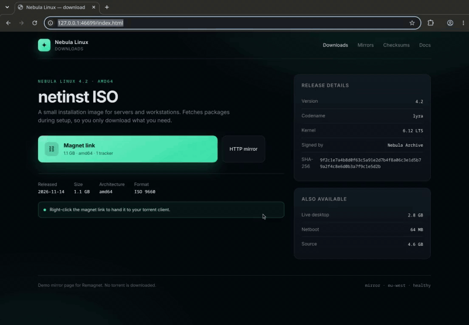

<p align="center">
  
</p>

# Remagnet

A Bun-powered monorepo for re-adding magnet links to torrent clients from the
browser. qBittorrent is the first backend; the extension uses a client-adapter
layer so other clients can be added without touching the UI or message code.

<p align="center">
  
</p>

<p align="center"><sub>
  Right-click a magnet link, review it, and send it to the client.
  Chrome is shown; in Firefox a <code>magnet:</code> click opens the same popover.
</sub></p>

## Layout

```
apps/
  extension/          WXT browser extension (SolidJS)
packages/
  qbittorrent/        Typed qBittorrent Web API v2 client
services/
  archive-bridge/     Rust/axum ZIP streaming bridge (optional)
```

- **Runtime / package manager:** [Bun](https://bun.sh) workspaces
- **Lint / format:** [Biome](https://biomejs.dev)
- **Extension:** [WXT](https://wxt.dev) + SolidJS + TypeScript
- **qBittorrent:** hand-rolled `fetch` client, no runtime dependencies
- **Archive bridge:** Rust + axum (optional ZIP downloads for completed torrents)

## Getting started

```bash
bun install
bun run dev:firefox   # Firefox is the primary development target
# bun run dev         # Chrome
```

Firefox opens with the extension already installed. Use the options page to
choose a client, point it at the Web UI, grant host access and set default
category/tags, then open the popup to see your torrents. The popup only lists
torrents that match those defaults (category or tags), so a shared qBittorrent
instance does not bury Remagnet's magnets under the rest of the library.

The popup can also remove a torrent from the client, either keeping or deleting
its files, and the background worker polls once a minute to raise a browser
notification when a Remagnet torrent finishes. Adding a magnet also happens in
the popover; a `magnet:` click hands the link to the popover instead of covering
the current page. See `apps/extension/README.md` for the full dev loop, including
how to print the `moz-extension://` URLs for the popup and options pages and how
to run it headless.

Open the extension's options page, enter the qBittorrent Web UI URL, and choose an
authentication method:

- **API key** (recommended, qBittorrent 5.2+): generate one under
  Preferences → Web UI → API Key. Requests use `Authorization: Bearer <key>`,
  with no login round-trip or cookies.
- **Username & password**: uses the classic SID cookie flow and re-authenticates
  automatically when the session expires.

Grant access to the qBittorrent origin when the browser prompts.

## Commands

| Command                 | Description                            |
| ----------------------- | -------------------------------------- |
| `bun run dev`           | Start WXT in dev mode (Chrome)         |
| `bun run dev:firefox`   | Start WXT in dev mode (Firefox)        |
| `bun run urls:firefox`  | Print dev extension popup/options URLs |
| `bun run build`         | Build the extension (Chrome)           |
| `bun run build:firefox` | Build the extension (Firefox)          |
| `bun run zip`           | Package the extension for distribution |
| `bun run test`          | Run unit tests (Bun test)              |
| `bun run typecheck`     | Type-check all workspaces              |
| `bun run check`         | Lint + format check with Biome         |
| `bun run check:write`   | Apply Biome fixes and formatting       |

## Archive bridge (optional)

Completed torrents can be streamed to the browser as a ZIP. The extension asks
the background worker to start the download, and the background worker requests
`/archive/<info-hash>` from a small Rust/axum bridge. The bridge reads files from
qBittorrent's Web API, so it needs neither the downloads volume nor temporary
disk space.

```bash
cd services/archive-bridge
cp .env.example .env        # set BRIDGE_TOKEN (openssl rand -hex 32) and QBIT_*
cargo run                   # http://127.0.0.1:8080/
```

Generate a token with `openssl rand -hex 32`, put the bridge behind an HTTPS
reverse proxy (for example `https://remagnet.example.com`), then enter that URL
and the same token under **Settings → Archive downloads**. Keep the token out of
the repository; it belongs in the server-side `.env` and in extension storage.

The bridge only streams torrents that are complete, accepts
`Authorization: Bearer <token>` (used by Firefox downloads) and `?token=` as a
fallback, and exposes a small config page at `/` for the qBittorrent URL and
credentials. See `services/archive-bridge/README.md` for deployment details.

## qBittorrent notes

- The client targets the qBittorrent **Web API v2** (`/api/v2`), supported by qBittorrent 4.1+.
- API key auth requires qBittorrent **5.2+** (Web API 2.14.1+). API keys cannot call the
  `auth/login` or `auth/logout` endpoints, so the client skips them entirely.
- In the extension (browser cookie mode) password authentication relies on the browser
  cookie store, so the extension needs host access to the qBittorrent origin. Grant it on
  the options page.
- Some qBittorrent versions apply CSRF/Referer checks to the Web UI API. If requests are
  rejected, enable "Bypass authentication for clients on localhost" or add the extension
  origin to the Web UI's trusted sources, depending on your qBittorrent version.
- Credentials are stored in `browser.storage.local` (plain text) and only used by the
  background worker. Prefer an API key or a dedicated qBittorrent user with limited
  permissions.

## Package usage

```ts
import { QBittorrentClient } from "@remagnet/qbittorrent";

// Preferred: qBittorrent 5.2+ API key (stateless).
const qbt = new QBittorrentClient({
  baseUrl: "http://127.0.0.1:8080",
  apiKey: "qbt_...",
});

// Legacy: username/password cookie auth.
const legacy = new QBittorrentClient({
  baseUrl: "http://127.0.0.1:8080",
  username: "admin",
  password: "adminadmin",
});

await qbt.login(); // no-op for API keys
const torrents = await qbt.getTorrents({ filter: "downloading" });
await qbt.addTorrent({ urls: "magnet:?xt=urn:btih:..." });
```

See `packages/qbittorrent/README.md` for the full API surface.
