<p align="center">
  
</p>

# Remagnet

[](https://github.com/EliCunninghamDev/Remagnet/actions/workflows/ci.yml)
[](LICENSE)

A torrent forwarding and download proxy for Firefox, Chrome, and Android.

Firefox handles magnet links through a `magnet:` protocol handler. Chrome adds a
context menu item on magnet links. The Android client handles magnet links
system-wide.

Clients talk only to the **Remagnet Proxy**, a small self-hosted service that is
the sole adapter between Remagnet and qBittorrent. The proxy owns the qBittorrent
Web UI credentials and the category/tags that mark Remagnet torrents; the
extension and Android app store only the proxy URL and token. Android onboarding
uses a QR code.

<p align="center">
  
</p>

<p align="center"><sub>
  Right-click a magnet link, review it, and send it to the client.
  Chrome is shown; in Firefox a <code>magnet:</code> click opens the same popover.
</sub></p>

## Quick start

Remagnet has three pieces: the browser extension or Android app, the
**Remagnet Proxy**, and qBittorrent. The proxy is required: it adds magnets,
lists and removes the torrents Remagnet owns, and streams completed torrents as
ZIP files. Clients never talk to qBittorrent directly, so qBittorrent does not
need to be exposed outside its Docker network or the host.

### 1. Prepare qBittorrent

Enable the Web UI and generate an API key under **Preferences → Web UI → API
Key** (qBittorrent 5.2 or newer). Note the Web UI URL reachable from the proxy;
only the proxy connects to it.

### 2. Deploy Remagnet Proxy

Create a directory on the Docker host and add `compose.yaml`:

```yaml
services:
  remagnet-bridge:
    image: ghcr.io/elicunninghamdev/remagnet-bridge:latest
    container_name: remagnet-bridge
    restart: unless-stopped
    env_file: .env
    environment:
      DATA_DIR: /data
      BIND_ADDR: 0.0.0.0:8080
    extra_hosts:
      - "host.docker.internal:host-gateway"
    ports:
      - "8080:8080"
    volumes:
      - remagnet-data:/data

volumes:
  remagnet-data:
```

Then create `.env` beside it:

```dotenv
# Generate with: openssl rand -hex 32
BRIDGE_TOKEN=replace-with-32-bytes-of-hex

# Where the proxy reaches qBittorrent's Web UI. If qBittorrent is another
# Compose service, use its service name and a shared network instead.
QBIT_BASE_URL=http://host.docker.internal:8080

# Optional: the proxy stores these on first boot, then the config page owns
# them. Leaving the API key blank lets you finish setup in the web UI.
QBIT_API_KEY=qbt_replace_with_your_key
QBIT_USERNAME=
QBIT_PASSWORD=

# Category and tags that mark torrents as Remagnet's. The proxy applies both to
# every magnet and uses them to decide which torrents it lists and removes.
REMAGNET_CATEGORY=remagnet
REMAGNET_TAGS=remagnet
```

Start the service:

```bash
docker compose pull
docker compose up -d
```

To build the image from this repository instead of pulling it:

```bash
git clone https://github.com/EliCunninghamDev/Remagnet.git
cd Remagnet/proxy
cp .env.example .env    # set BRIDGE_TOKEN and QBIT_* values
docker compose up -d --build
```

### 3. Configure the proxy

Open `http://<docker-host>:8080` and paste the same `BRIDGE_TOKEN`. That field
only unlocks the proxy's own settings page; it is not a second password. Point
the proxy at qBittorrent with the Web UI URL and API key, then choose **Test
connection**. The proxy boots without qBittorrent credentials, so this page is
also where you can finish setup if `.env` left them blank.

### 4. Connect Remagnet

Pair the extension from the proxy page: choose **Copy link** in the **Pair a
device** panel and paste it into **Settings → Remagnet Proxy → Pairing code**.
The link fills in the proxy URL and token; the extension never receives
qBittorrent credentials.

For Android, scan the panel's rotating QR code from the app. The phone claims a
one-time code and stores the same proxy URL and token. The code rotates every
minute and works once, so keep it private. Pairing needs an HTTPS proxy origin;
you can also enter the URL and token under **Settings**.

The proxy owns the category/tags applied to magnets and the filter used by every
client. A paired device therefore adds and removes only the torrents the proxy
considers Remagnet's, and qBittorrent credentials stay on the proxy.

Expose the proxy over HTTPS before using it from another machine. A minimal
Caddy route for the Compose setup in this repository looks like:

```caddyfile
remagnet.example.com {
  reverse_proxy remagnet-bridge:8080
}
```

The proxy never stores torrent contents; it streams each completed file from
qBittorrent's Web API into the ZIP response.

## Layout

```
extension/            Firefox and Chrome extension (WXT, SolidJS)
proxy/                Rust/axum service, OpenAPI contract, ZIP streaming
android/              Android client (Kotlin, Jetpack Compose)
packages/
  proxy-client/       TypeScript client generated from the proxy contract
demo/                 Scripted demo recording
docs/                 Banner and demo media
scripts/              Client and banner generation
tokens.js             Design tokens (DTCG 2025.10)
```

## Development

```bash
bun install
bun run dev:firefox   # Firefox is the primary target
# bun run dev         # Chrome
```

Firefox starts with the extension installed and keeps its settings in
`extension/.dev/firefox-profile/`. Pair the extension from your proxy page, or
enter the proxy URL and token on the options page, then grant access to that
origin. The popup shows only the torrents the proxy exposes, so a shared
qBittorrent instance does not bury Remagnet's magnets under the rest of the
library. Category, tags and qBittorrent credentials are configured on the proxy.

## OpenAPI Spec

[`proxy/openapi.yaml`](proxy/openapi.yaml) is the contract for every client that
speaks to the proxy. It is OpenAPI 3.1 and covers both authentication styles,
health and configuration, the torrent endpoints, pairing, the archive stream and
each error status.

The TypeScript and Kotlin clients are generated from it, not maintained by hand:

- `packages/proxy-client`: types and an `openapi-fetch` wrapper for the
  extension.
- `android/proxy-client`: Retrofit sources with a streaming archive response.

```bash
bun run api:generate   # needs JDK 21; writes both clients
```

Commit the regenerated sources with any spec change so both builds stay
reproducible without running the generator.

## Design Tokens

[`tokens.js`](tokens.js) holds the visual system in the
[Design Tokens Community Group 2025.10 format](https://www.designtokens.org/tr/2025.10/format/):
light, dark and popup color schemes, type scale, spacing, layout dimensions and
motion. It is a plain ES module, so scripts import it directly, and
`JSON.stringify(tokens)` produces a valid `.tokens.json` document.

`extension/assets/app.css` mirrors the tokens for the extension pages;
`bun run test` checks the token structure and value types. The wordmark
(`extension/components/Wordmark.tsx`) is shared by the extension and the proxy
config page. Android reuses the palette and the launcher mark.

The README banner is generated by `bun run banner:generate` from the popup
tokens, bundled Geist Mono and Departure Mono faces, the measured 440px
popover, the application icon and the runtime bar geometry. Regenerate the SVG
rather than editing it.

## Extension - WXT + SolidJS

Firefox is the primary target; its manifest declares a `magnet:` protocol
handler, so a magnet click opens the review popover and leaves the current page
in place. Chrome has no extension protocol handlers, so it uses a right-click
menu item that appears only on magnet links, plus the popover's **Add** button.

The background worker is the only context that talks to the Remagnet Proxy.
Popup, add and options pages send typed messages to it (`lib/messages.ts`,
`lib/torrent-service.ts`). That service uses `@remagnet/proxy-client`, whose
types are generated from `proxy/openapi.yaml`; there is no local torrent-client
adapter, and qBittorrent credentials never reach the browser. The extension
requests host access to one origin, the configured proxy.

The toolbar popover is the main UI. Each row is a name, a 3-block tile bar, live
stats, and inline **Download** and remove actions. The percentage is a tile-font
counter at the bar's right end, and the bar's fill color carries status: steel
blue downloading, sage ready, ochre stalled or zipping, gray paused or errored.
Removal asks whether to keep or delete the files and answers in the row itself.
While open, the popover polls once a second during downloads and once every five
seconds when everything is complete; the background worker polls once a minute
when it is closed and raises a browser notification on completion.

See [`extension/README.md`](extension/README.md) for the full development
loop, including the Firefox protocol handler, Chrome menu behavior,
`moz-extension://` URLs and headless runs.

### Component gallery

`/gallery.html` is a development page with fixed fixtures for token swatches,
controls, every torrent-row state, the popover's loaded/empty/loading/error
lists and the add-flow review screens. It is the visual reference when changing
the design and needs no configured torrent client.

```bash
bun run dev:firefox
bun run urls:firefox   # prints the gallery URL with the other dev pages
```

The gallery is excluded from packaged builds; set `REMAGNET_GALLERY=1` before a
build to include it for review against an installed extension. Component tests
(`bun run test:ui`, Vitest + happy-dom) render the same fixtures from
`extension/gallery/fixtures.ts`.

## Proxy - Rust / Axum

`proxy/` is the only component that talks to qBittorrent. It owns the Web UI
credentials and the category/tags applied to Remagnet magnets, exposes neutral
torrent endpoints to the clients, and streams a completed torrent as a ZIP. It
reads files from qBittorrent's Web API, so it needs neither the downloads volume
nor temporary disk space.

| Endpoint                     | Auth   | Purpose                                               |
| ---------------------------- | ------ | ----------------------------------------------------- |
| `GET /`                      | none   | Config page for the qBittorrent connection            |
| `GET /healthz`               | none   | Liveness probe                                        |
| `GET /api/health`            | bearer | Proxy capabilities, defaults and qBittorrent versions |
| `GET /api/config`            | bearer | Read non-secret settings                              |
| `PUT /api/config`            | bearer | Update qBittorrent credentials and magnet defaults    |
| `GET /api/torrents`          | bearer | List torrents owned by Remagnet                       |
| `POST /api/torrents`         | bearer | Add magnets with the configured category/tags         |
| `GET /api/torrents/:hash`    | bearer | Read one torrent, unfiltered                          |
| `DELETE /api/torrents/:hash` | bearer | Remove a Remagnet-owned torrent                       |
| `POST /api/pair`             | bearer | Mint a short-lived device pairing code                |
| `POST /api/pair/claim`       | none   | Claim a code; returns encrypted proxy token           |
| `GET /archive/:hash`         | bearer | Stream a completed torrent as a ZIP                   |

`Authorization: Bearer <BRIDGE_TOKEN>` is preferred; `?token=` is a fallback for
browsers whose download API cannot attach headers. `GET /api/torrents` filters
by the configured category/tags, `POST /api/torrents` always applies them, and
`DELETE /api/torrents/:hash` refuses torrents outside that filter. Only complete
torrents are served as ZIPs. Entries are stored uncompressed (media files do not
benefit from ZIP deflation), and a failed upstream stream aborts the response so
the browser cannot save a truncated archive.

```bash
cd proxy
cp .env.example .env        # set BRIDGE_TOKEN (openssl rand -hex 32) and QBIT_*
cargo run                   # http://127.0.0.1:8080/
```

`BRIDGE_TOKEN` must be at least 16 characters. `QBIT_BASE_URL`, `QBIT_API_KEY`
or `QBIT_USERNAME`/`QBIT_PASSWORD`, `REMAGNET_CATEGORY`, `REMAGNET_TAGS`,
`DATA_DIR` and `BIND_ADDR` configure the service. The proxy starts without
qBittorrent credentials and answers the torrent and archive endpoints with `503`
until they are saved. The first boot writes `config.json` (mode `0600`) from the
environment; subsequent changes come from the config page and survive restarts.
Deploy behind an HTTPS reverse proxy, then pair the extension or enter that URL
and the same token under **Settings → Remagnet Proxy**. A compose file is
included for the shared `media` network.

The crate, binary, Docker image and container keep the historical
`remagnet-bridge` name, as does the token variable, so existing deployments and
reverse-proxy upstreams continue to work. See [`proxy/README.md`](proxy/README.md)
for deployment, configuration and tests.

## Android Client - Kotlin

`android/` builds the Kotlin + Jetpack Compose client. It is proxy-only: the
settings screen stores the Remagnet Proxy URL and token, `ProxyTorrentClient`
implements listing, lookup, add and remove through the proxy's neutral torrent
API, and `ProxyApi` configures the generated Retrofit client with the bearer
token. Magnets arrive through `VIEW magnet:` links or shared text and open a
review sheet over the home screen, with duplicate detection, the proxy's
category/tag defaults and pause-on-add. The magnet parser mirrors the
extension's semantics. `:proxy-client` holds the generated proxy sources; the
archive endpoint is a streaming response, so downloads stream to disk instead of
buffering the ZIP in memory.

```bash
bun run android:build                 # ./gradlew :app:assembleDebug
bun run android:test                  # ./gradlew :app:testDebugUnitTest
cd android && ./gradlew :app:lintDebug
cd android && ./gradlew :app:installDebug
```

The remaining Android polish and release work is tracked in
[`android/PLAN.md`](android/PLAN.md). The toolchain, emulator setup, QR payload
format and install steps are documented in
[`android/README.md`](android/README.md). Cleartext HTTP is allowed only for the
emulator host (`10.0.2.2`) and loopback; a deployed proxy must use HTTPS.

## Releases

Every component shares one version. Bump it everywhere, check it, then tag:

```bash
bun run version:set 0.1.1
bun run version:check v0.1.1
git add -A
git commit -m "Release 0.1.1"
git tag v0.1.1
git push origin main --tags
```

`version:set` updates the root, extension, and workspace package manifests, the
proxy `Cargo.toml` and `Cargo.lock`, the Android default version, and
`bun.lock`. `version:check` rejects a tag that does not match those files.

A `vMAJOR.MINOR.PATCH` tag runs the **Release** workflow, which tests the
extension and proxy, builds every package, and publishes:

- `remagnet-<version>-chrome.zip` and `remagnet-<version>-firefox.zip`, plus the
  Firefox source ZIP for addons.mozilla.org review.
- `remagnet-<version>.apk` and `remagnet-<version>.aab` when Android signing
  secrets are configured. Without them, the release carries an installable
  `remagnet-<version>-debug.apk`.
- `SHA256SUMS` for every asset.
- `ghcr.io/elicunninghamdev/remagnet-bridge` tagged `<version>`,
  `<major>.<minor>`, `<major>`, and `latest`.

Store submission is still manual: upload the extension ZIPs to the Chrome Web
Store and addons.mozilla.org. Android release signing needs
`ANDROID_KEYSTORE_BASE64`, `ANDROID_KEYSTORE_PASSWORD`, `ANDROID_KEY_ALIAS`,
and `ANDROID_KEY_PASSWORD`; [`android/PLAN.md`](android/PLAN.md) covers creating
the key. To retry a release without moving its tag, run the Release workflow
manually with the tag name.

## Sponsor this project

Remagnet is built and maintained in the open. If it saves you time, you can
[support this project on Ko-fi](https://ko-fi.com/elijahcunninghamdev).

## Privacy and license

Remagnet runs entirely on your devices and your own server. It has no accounts,
analytics, or telemetry, and it sends nothing to the project. See
[`PRIVACY.md`](PRIVACY.md) for what each component stores locally.

The source is licensed under the [Apache License 2.0](LICENSE).

## Commands

| Command                   | Description                            |
| ------------------------- | -------------------------------------- |
| `bun run dev`             | Start WXT in dev mode (Chrome)         |
| `bun run dev:firefox`     | Start WXT in dev mode (Firefox)        |
| `bun run urls:firefox`    | Print dev extension popup/options URLs |
| `bun run build`           | Build the extension (Chrome)           |
| `bun run build:firefox`   | Build the extension (Firefox)          |
| `bun run zip`             | Package the extension for distribution |
| `bun run zip:firefox`     | Package Firefox and its source ZIP     |
| `bun run version:check`   | Verify every component version         |
| `bun run version:set`     | Set the version across components      |
| `bun run test`            | Run unit and component tests           |
| `bun run test:unit`       | Run Bun unit tests                     |
| `bun run test:ui`         | Run Vitest component tests             |
| `bun run api:generate`    | Regenerate the proxy API clients       |
| `bun run banner:generate` | Regenerate the README banner           |
| `bun run typecheck`       | Type-check all workspaces              |
| `bun run check`           | Lint + format check with Biome         |
| `bun run check:write`     | Apply Biome fixes and formatting       |
| `bun run android:build`   | Build the debug Android APK            |
| `bun run android:test`    | Run Android JVM unit tests             |

## qBittorrent notes

- The proxy targets the qBittorrent Web API v2 (`/api/v2`), supported by
  qBittorrent 4.1+.
- API key auth requires qBittorrent 5.2+ (Web API 2.14.1+). API keys cannot call
  `auth/login` or `auth/logout`, so the proxy skips them.
- qBittorrent only needs to be reachable from the proxy. It does not need to be
  exposed outside the Docker network or host, and browser CSRF/cookie rules no
  longer apply because requests are server-to-server.
- The proxy owns the category/tags applied to new magnets and the filter used by
  every client. Clients cannot override them, and only matching torrents can be
  listed as Remagnet's or removed.
- qBittorrent credentials live only on the proxy, in `config.json` with mode
  `0600`. The extension and Android app store only the proxy token, encrypted
  with a non-exportable key (AES-GCM in the extension, Android Keystore on the
  phone).
